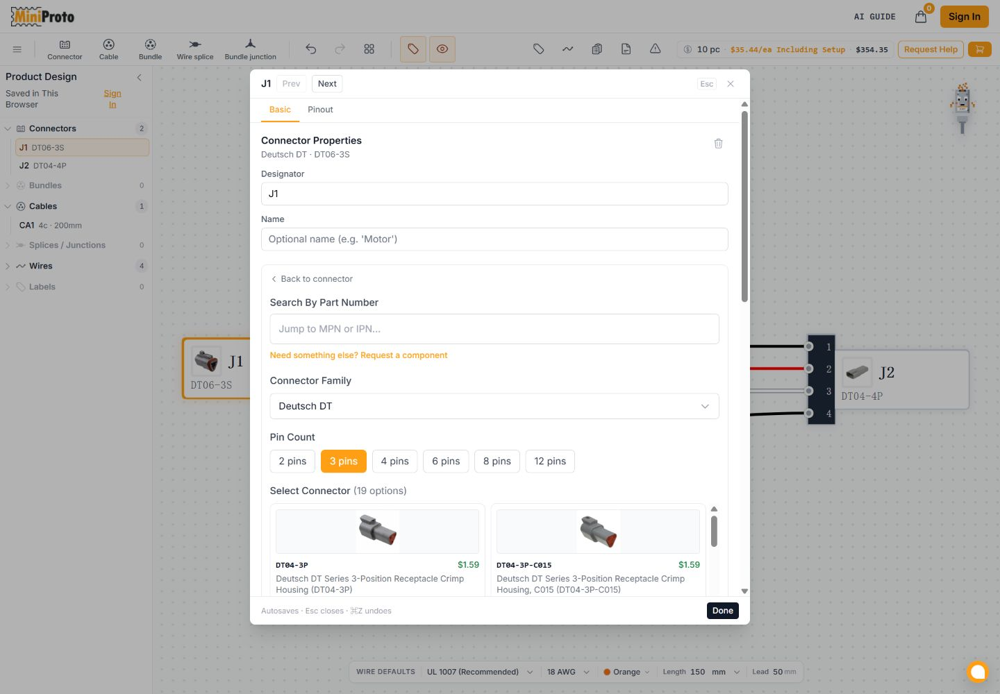
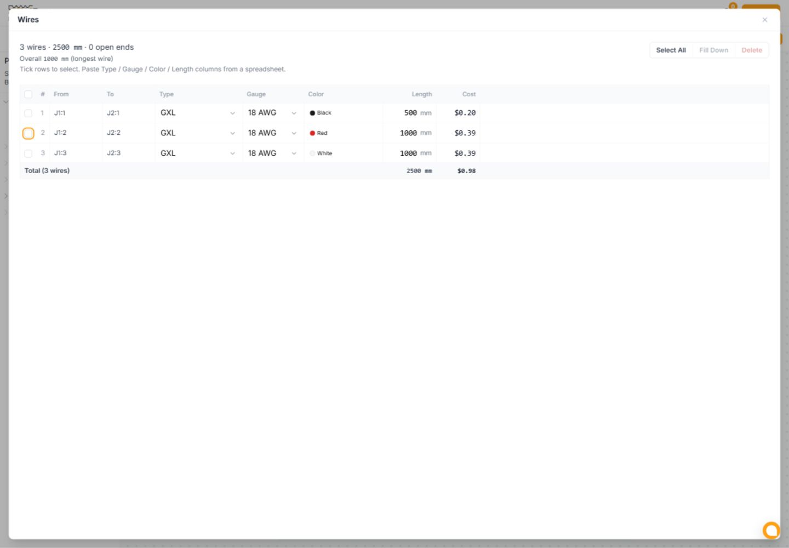
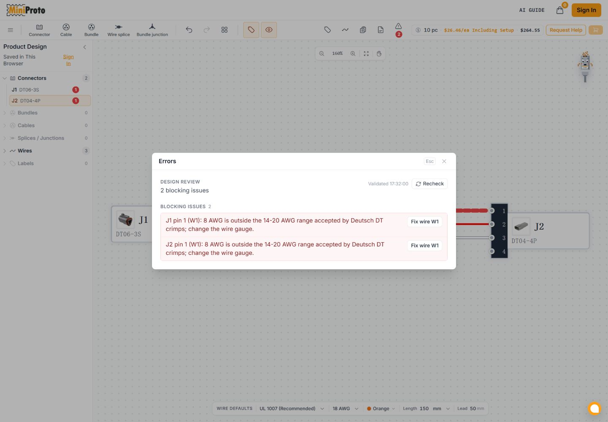
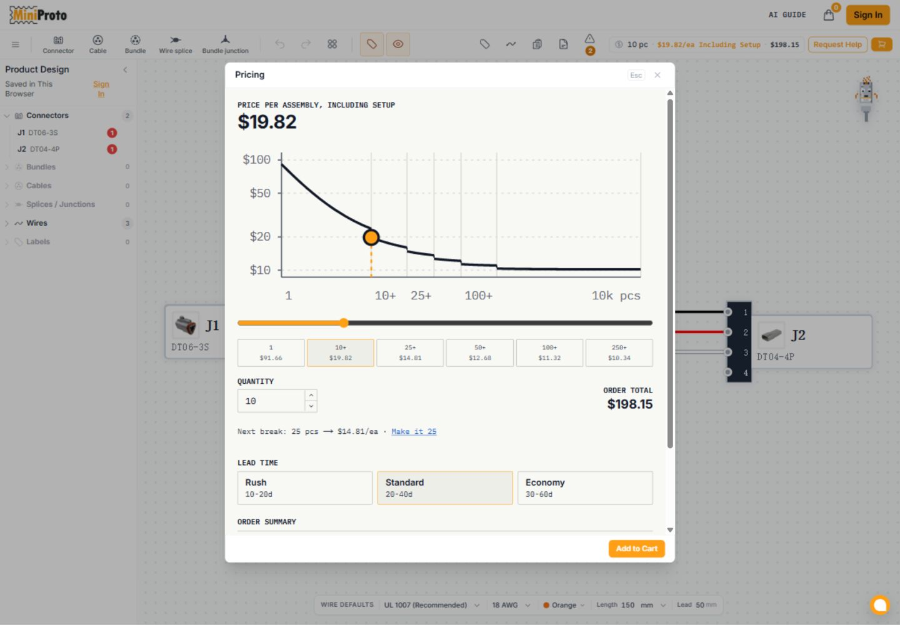
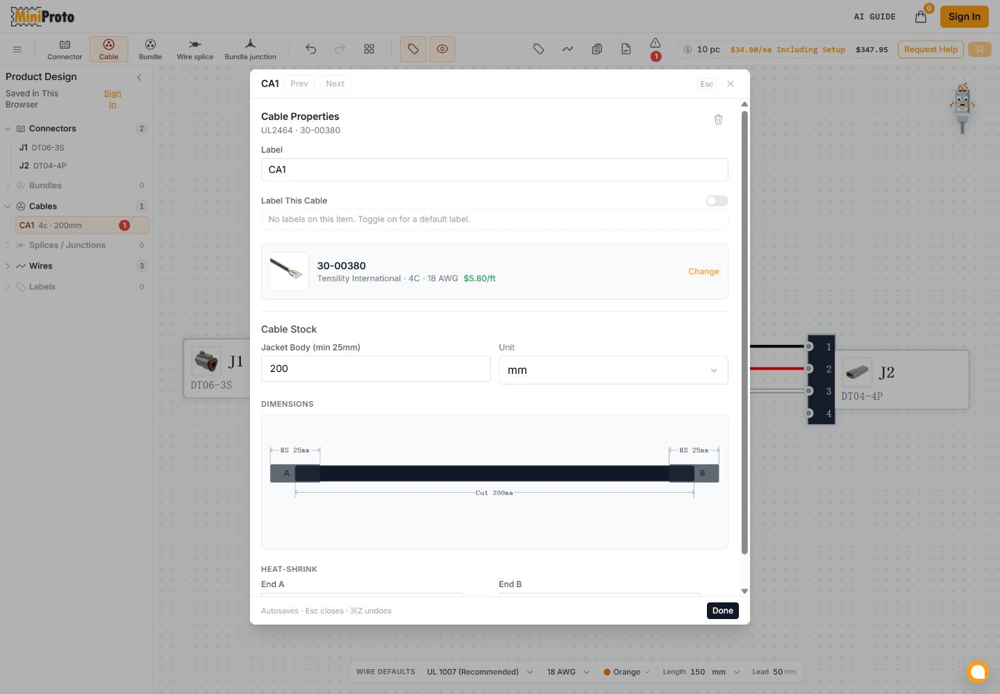
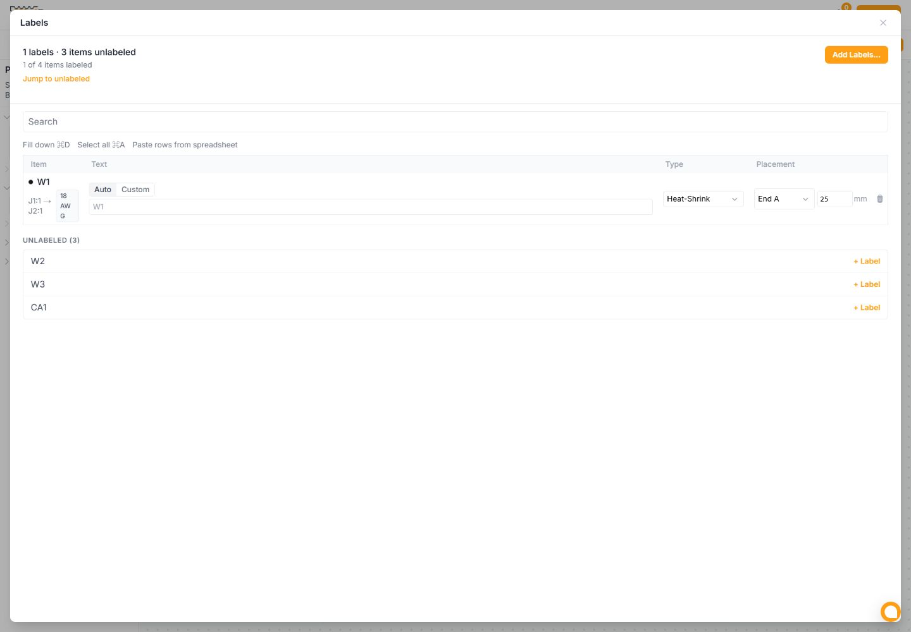

# MiniProto 中文操作说明手册

更新日期：2026-11-17。适用入口：[MiniProto Configurator V2](https://www.miniproto.com/configuratorV2)。

本手册用于自己动手了解竞品，不是生产接线规范。操作依据为2026-11-16浏览器实测，以及2026-11-17重新读取的官方Guide。价格、目录和界面可能变化；以当前界面为准。

## 1. 你现在应该从哪里开始

**不用清空之前的画布。** 你此前截图里已有J1（No Part）和CA1（4芯、200 mm），可以直接从第8节继续。先完成选料，再接线；购物车与设计画布是不同区域。

如果你更想先理解基础操作，按第4–7节做“两个连接器、三根独立导线”练习，然后再做第8节电缆练习。已有重要内容时，先确认已保存并可重新打开，再使用左上角File → New Project。访客新建项目的旧草稿保留方式未验证，不要把它当成可靠备份。

学习目标分为三段：

| 阶段 | 你要完成的内容 | 完成标志 |
| --- | --- | --- |
| 基础 | 选连接器、接线、修改长度、处理提示 | 能在Wires表中解释每一行接到哪里 |
| 业务 | 查看BOM、切换数量、加标签 | 知道哪些材料和加工选择影响报价 |
| 扩展 | 使用多芯电缆、观察检查边界 | 知道电缆芯线与独立导线如何分别表达 |

## 2. 准备与保存

1. 用电脑浏览器打开配置器，建议最大化窗口。出现 `Editing requires a larger screen` 时，扩大浏览器可用宽度；必要时折叠侧栏或适当降低浏览器缩放。
2. 首次出现 `Build your harness guide` 时可以阅读，也可以关闭；以后从File → Guide重新打开。
3. 查看左侧项目名。访客会显示 `Saved in This Browser`，只说明保存在当前浏览器；换浏览器、清理站点数据或无痕窗口都不能当作同一保存位置。
4. 重要练习如需长期保存，自行登录后确认能从 `File → Your Projects...` 重新打开。官方指南描述登录后可云保存；本轮未验证跨设备恢复。
5. 等 `Unsaved Changes` 和 `Updating estimate...` 结束，再记录或离开页面。自动保存与估价更新是不同状态，分别观察。

## 3. 先认识界面

| 英文名称 | 中文含义 | 使用位置或作用 |
| --- | --- | --- |
| Connector | 连接器 | 顶部工具栏，放置接线端部 |
| Cable | 成品/多芯电缆 | 有既定芯数与芯线规格的实体电缆 |
| Bundle | 线束段 | 将多根线组织在一段套管或护层中；不同于直接购买的电缆 |
| Wire splice | 导线接续点 | 连接导线的接续对象，复杂语义待进一步实测 |
| Bundle junction | 线束分支点 | 组织线束分支，不直接等于电气短接 |
| Wires | 接线表 | 顶部波浪线图标，查看From/To和线材规格 |
| BOM | 物料清单 | 顶部清单图标，查看材料和单位 |
| Errors | 设计检查 | 顶部三角叹号，查看警告与阻断 |
| Pricing | 报价 | 顶部数量和金额区域，点击可展开 |
| Labels | 标签 | 顶部标签图标，设置文字、类型和位置 |
| X-Ray | 透视 | 工具栏眼睛图标；查看线束段里的线 |
| Request Help | 请求工程帮助 | 将设计提交给对方工程团队的入口 |
| Add to Cart | 加入购物车 | 采购流程入口，学习无需点击 |
| Crimp | 压接端子 | 逐孔端子型号，与线径适配有关 |
| Wedgelock | 锁片/二次锁 | 某些Deutsch连接器的保持附件 |

鼠标悬停图标可辅助识别名称。属性优先双击画布对象打开；左侧树用于找对象、选择和定位，具体单击行为以当前界面为准。

## 4. 基础练习：放置与选择连接器

练习配置沿用已验证的目录示例，不是推荐的实际产品组合：

| 对象 | 型号 | 孔数 | 本次用途 |
| --- | --- | --- | --- |
| J1 | DT06-3S | 3 | 三根线的起点 |
| J2 | DT04-4P | 4 | 前三孔接线，第4孔留给电缆扩展练习 |

J1、J2孔数不同，是练习用线束的两个不同端点，不代表它们能直接互相插合。

1. 已有该示例时直接使用；空画布则点击顶部 `Connector`，再点击画布左侧放置J1。
2. 如果还处于放置模式，再点一次Connector退出，避免每点一次画布就增加一个对象。
3. 双击J1，打开属性。占位对象需要先选系列、孔数、料号；已经有型号则使用 `Change`。
4. 选择 `Deutsch DT` 系列、3 pins，搜索或选择 `DT06-3S`。
5. 检查标题、孔数、图片和料号，再点 `Done`。
6. 用同样方式在右侧放J2，选择4 pins和 `DT04-4P`。

**检查点：** 左侧Connectors应有2个；画布不再只显示 `No Part`；J1有3个接点、J2有4个。型号搜不到时先清除不匹配的系列/孔数筛选，不要随意替换为同名不同后缀物料。

## 5. 建立三根独立导线

1. 在底部 `WIRE DEFAULTS` 设置新线默认规格：18 AWG、长度1000、单位mm；线材系列可用目录里的GXL（与历史示例一致），颜色先选黑色。
2. 从J1的1号圆点按住拖到J2的1号圆点，释放鼠标。拖的是接点，拖连接器本体只会移动对象。
3. 同样建立J1:2 → J2:2、J1:3 → J2:3。
4. 双击导线分别设为黑、红、白；已建好的线也可以从Wires表改规格。底部默认值主要作用于新线，不能假定会批量改变旧线。
5. 打开Wires表，逐行核对From、To、Gauge、Color、Length。

| 行 | From | To | Gauge | Color | Length |
| --- | --- | --- | --- | --- | --- |
| 1 | J1:1 | J2:1 | 18 AWG | Black | 1000 mm |
| 2 | J1:2 | J2:2 | 18 AWG | Red | 1000 mm |
| 3 | J1:3 | J2:3 | 18 AWG | White | 1000 mm |

**检查点：** 三行接线、总长3000 mm、开放端统计为0。J2第4孔暂时不用；本练习未确认实际生产中空孔是否需要堵件。

### 修改长度，观察联动

1. 在Wires表第一行把1000改为500，按Tab或点其他字段提交。
2. 检查第一行变500 mm，总长变2500 mm，另外两行保持1000 mm。
3. 等估价更新结束，记录报价前后变化。画面上连线看起来同样长，不代表实际长度相同；官方Guide明确这是示意布局，不是1:1制造图。

历史实测中，数量10时该改动使总价从$198.15变为$194.35。这只是当时配置的参考，不要求今天得到完全相同价格。

## 6. 处理设计检查

点击顶部三角叹号进入Errors。

### 缺少锁片

如果出现 `Missing Wedgelock`：

1. 点击J1的 `Add wedgelock`，进入J1属性中相关附件位置。
2. 找到兼容的W3S并勾选，核对数量1，再点Done。
3. J2同样选择兼容W4P、数量1。
4. 回Errors检查；必要时点击Recheck。只点Add wedgelock不等于已经加入，必须看到附件被选中。

`Continue without wedgelock` 表示有意省略，不是补齐；学习时优先实际选择兼容件。若已经选择了其他等效保持件，不要盲目重复加料，应核对当前提示和型号。

### 可选：验证错误能否拦截

仅在可恢复的练习配置中做：

1. 在Wires表把第一根18 AWG改为8 AWG。
2. 打开Errors，观察是否分别提示J1/J2允许14–20 AWG；加入购物车应禁用。
3. 点 `Fix wire W1`，进入该线属性，查看兼容线径提示。
4. 改回18 AWG、Done，再检查阻断消失。

**检查点：** 能解释警告原因并实际修正。`No design errors` 只表示当前检查未发现阻断，不代表所有端部、未用芯线、加工要求和制造资料都已完整。

## 7. 看懂BOM与报价

### BOM

1. 点击Open BOM。
2. 查连接器壳体、端子和已选锁片是否出现。
3. 查看Wire & Cable里的规格、数量单位、单价及小计。
4. 同料号端子可能逐孔分行显示，不一定自动合成一行。

注意单位：`ea`为件，`ft`为英尺（1 ft = 304.8 mm）。BOM线材用量可能与接线表长度不同；历史实测1000 mm线在BOM显示3.77 ft，余量/损耗公式未核实。不要擅自把该差异理解为固定比例，也不要拿材料成本当最终售价。

### 报价

1. 点击右上角数量及金额区域。
2. 先看Quantity = 1的含设置费单价和总价。
3. 点击10件档位，等Updating estimate结束，再看单价、总价、Setup和Variable Assembly Price。
4. 可以继续记录25、50等档位；每次只改变数量，方便判断原因。
5. 交期有Rush / Standard / Economy入口。本轮未实测交期如何改变价格，不要推断选择更慢一定便宜。

历史示例1件$91.66，10件显示$19.82/件、总价$198.15；显示单价经过舍入，乘数量不一定恰好等于总价。具体目录价格和设置费以当前页面为准。

## 8. 从你现有的J1＋CA1画布继续

你之前的画布是：J1未选料、CA1为4芯200 mm、Wires为0。它还没有建立接线，不需要清空。

### 8.1 先完成选料

1. 双击CA1打开Cable Properties。
2. 若没有具体料号，选择Cable Family，再按4C筛选或搜索 `30-00380`；确认4芯、18 AWG、UL2464。型号不可用时记录替代物料规格，不能假定所有4芯电缆相同。
3. 设置 `Jacket Body` = 200 mm；核对End A/End B热缩参数。历史测试默认各25 mm。它们是热缩参数，不等同于芯线外露长度。
4. 点Done。
5. 双击J1，为其选择4孔、接受18 AWG的连接器；例如可在Deutsch DT的4孔候选中选择实际存在的合适型号。`DT04-4P`已经实测可用；其他型号应核对目录和附件，不把示例视为实际选型建议。

### 8.2 接入一芯，理解它如何建模

1. 退出Connector/Cable放置模式。
2. 从连接器1号接点拖到CA1一端的第一芯圆点。电缆外侧较大的圆形手柄用于姿态操作，接线要落在芯线小圆点。
3. 打开Wires，应出现类似 `J1:1 → CA1:1` 的记录；编号以你的连接器名称为准。
4. 检查Type是否显示CA1，而不是将其理解成又购买了一根独立线。
5. 打开BOM，确认实体电缆以料号出现。

**已实测的边界：** 测试中的 `J2:4 → CA1:1` 成功生成了一条cable conductor记录；仅连接一芯就消除了“电缆未接入”的阻断。因此检查通过不能证明电缆两端和全部芯线都已处理。

### 8.3 继续做完整两端练习

如果要把该练习做完整，在CA1另一端放置第二个合适的4孔连接器，逐芯完成1→1、2→2、3→3、4→4接线。接完后检查每根芯线的两端和未用端处理。

这一完整两端操作尚未在当前版本受控验证；如果接线表把电缆左右端合并、只显示一侧，或不能按预期接入，保留画布并截图，不要通过重复增加独立导线来“补齐”电缆。先查清电缆端部和芯线表示方式。

不要同时照搬第5节独立线接法与本节电缆接法到同一组已占用孔位，以免产生重复连接。可以在另一个已保存的练习项目中分别比较。

## 9. 添加一个标签

1. 打开Labels，找到UNLABELED列表。
2. 点击 `Add label to W1`，确认表中出现W1。
3. 查看Text（Auto/Custom）、Type、Placement以及Offset。
4. 初次可保留自动文字W1、A端25 mm偏移，再查看画布和报价变化。
5. 要修改文字，先切换Custom；不要假定修改Designator与标签文字永远相互独立。

## 10. 保存、交接与结束位置

1. 等待显示Saved in This Browser或当前登录态的已保存状态。
2. 记录项目名、浏览器、关键料号和配置截图。对重要内容，确认能从项目列表重新打开后再关闭。
3. 如要了解人工工程交接，打开Request Help查看说明和邮箱字段；学习阶段查看后Cancel即可。点击提交会把设计发给对方团队。
4. 本次学习到“接线可解释、检查已处理、BOM可核对、报价变化已记录”就完成。无需加入购物车或付款。
5. 你先前购物车有8项，与当前画布对象数量不是一回事。无需为学习清空购物车，也不要把购物车商品名当作当前画布的项目保存记录。

File菜单中的Share Design、Library、Duplicate和Version History可能受登录或权限限制。Library在访客实测中要求登录；Share Design未验证成功；本手册不承诺PDF/Excel导出入口，避免把Livewire的导出方式套用到MiniProto。

## 11. 常见问题

| 现象 | 先检查什么 | 下一步 |
| --- | --- | --- |
| 点击画布不断增加对象 | 顶部Connector/Cable是否仍选中 | 再点同工具退出；误操作用Undo |
| 拖动只移动了连接器 | 是否拖了本体而非接点 | 从PIN小圆点拖到目标小圆点 |
| 拖不动视图或接点 | 是否启用了Pan工具 | 退出Pan再接线；用Fit view找回全图 |
| 看不到整张图 | 缩放过大或视图偏移 | 点击Fit view，或按F |
| 搜不到料号 | 系列/孔数筛选与料号冲突 | 清除筛选后重新查 |
| 价格暂时为 -- | 正在Updating estimate | 等待；持续失败先记录错误，不重复加购物车 |
| 已有价格但不能加入购物车 | 有制造/接线阻断 | 打开Errors查看具体对象与原因 |
| 缺锁片提示没消失 | 只点了定位按钮，尚未勾选附件 | 回连接器属性检查型号及数量 |
| 接线表有线，BOM没单列同样线 | 该线是否属于电缆芯线 | 查实体Cable料号，避免重复计料 |
| 更换系列后端子/附件变化 | 官方Guide说明更换系列会重置这些选择 | 先定系列与型号，再精调端子和附件 |
| 刷新后内容不见 | 是否换了浏览器/无痕窗口或清理了数据 | 检查原浏览器或已登录项目列表；无备份时不能保证恢复 |

## 12. 可复制的操作记录

每次只改变一个条件，记录这些内容便于后续比较我们的系统：

| 项目 | 你的记录 |
| --- | --- |
| 日期、浏览器、项目名 | |
| 连接器料号、孔数、端子/附件 | |
| 导线/电缆料号、芯数、线径、长度 | |
| From-To是否符合预期 | |
| 改动前 → 改动后 | |
| 警告/阻断数量与修复入口 | |
| 数量、单价、设置费、总价 | |
| BOM单位和实际用量 | |
| 保存方式、是否能重新打开 | |
| 不好理解的操作/截图 | |

推荐截图位置：连接器属性、Wires表、Errors、BOM、Pricing，以及最终画布。遇到不一致时把“你点击了什么”和“结果是什么”一起记录。

## 13. 功能验证范围

- 已实测：连接器选型入口、逐孔端子与附件显示、拖线、单行规格修改、锁片选择、错误线径阻断与恢复、多芯电缆选料并接一芯、BOM、数量报价、标签、同浏览器刷新恢复。
- 官方Guide描述但未逐项实测：复杂线束分支、splice、全部快捷键、跨设备云项目管理等。
- 未确认：完整多芯电缆两端接线、导线BOM余量公式、分享成功及权限、PDF/Excel导出、实际工程审核与下单交付。

更多测试细节见[竞品实测报告](research/miniproto-2026-11-16/report.md)。
