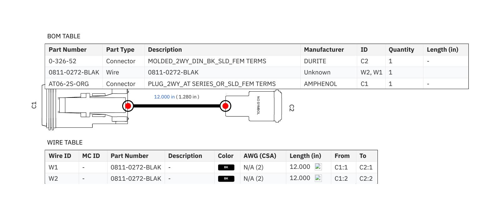

# Livewire 登录后浏览器实测报告

日期：2026-11-17。入口：[Livewire](https://livewirecad.ai/)。

本报告补充此前用户截图调研，重点核验接线、两种视图关联、长度联动、连接器替换和真实PDF输出。MiniProto的用户操作步骤见[中文操作手册](../../miniproto-operation-manual-2026-11-17.md)，历史对比见[调研上下文](../../livewire-miniproto-research-context-2026-11-16.md)。

## 1. 结论

可以借鉴Livewire的工程工作流：连接关系进入布局后复用已有连接器；线束段长度驱动线表；连接器替换前明确映射；同一项目生成工程表格和PDF。MiniProto更适合借鉴配置检查、问题定位、真实选料与报价的操作衔接。

本次确认了上述简单案例的行为，但没有证实完整制造校验、导线加工余量、线材BOM计量公式或复杂分支同步。不能把任一绿色状态直接当作可生产结论，也不应照搬竞品未解释清楚的规则。

## 2. 操作范围与证据

- 用户自行登录；没有获取、记录或保存密码。登录页显示版本`p.r.2026.11.06.89`。
- 首页可见原有`Untitled Design`、`Untitled Design (1)`、`Untitled Design (2)`及Demo；本次没有编辑它们。
- 使用Create Design创建独立项目`Untitled Design (3)`，全部设计修改均在该项目内完成。
- 没有分享、邀请、发送咨询、提交订单、付款或上传真实客户资料。
- 本次仅修改调研文档与证据文件，没有修改本系统业务代码、数据库，也没有提交或推送。

核验项目入口（需要同一账号登录）：

- [Schematic](https://livewirecad.ai/v1/nextgen/ecad?appname=integratedDesignEnvironment&id=6afba936f83350fed85f3d57&taskId=6afba936f83350fed85f3d56&module=schematic)
- [Harness](https://livewirecad.ai/v1/nextgen/ecad?appname=integratedDesignEnvironment&id=6afba936f83350fed85f3d58&taskId=6afba936f83350fed85f3d56&module=harness)

项目链接用于定位本次案例，不是公开分享链接。文中尺寸换算只是计算，不表示本轮实测了公制切换。

## 3. 受控案例

| 对象 | 初始/中间状态 | 最终状态 |
| --- | --- | --- |
| C1 | DURITE `0-326-52`，2孔 | 替换为AMPHENOL `AT06-2S-ORG`，2孔 |
| C2 | DURITE `0-326-52`，2孔 | 保持原料号 |
| W1 | C1:1 → C2:1 | 连接保持；`0811-0272-BLAK`、BK、CSA 2 mm² |
| W2 | C1:2 → C2:2 | 连接保持；同一线材料号及规格 |
| B01 | Auto Bundle生成，包含W1/W2 | Defined Length 12.000 in；Calculated Length 1.280 in |
| 图表 | 插入Wire Table、BOM Table | 随连接器替换和长度变更更新 |
| 输出 | 整图PDF | 实际下载并检查单页文件 |

该线材料号的AWG栏显示`N/A (2)`，不能把它记为18 AWG。该案例仅用于产品核验，未做生产选型确认。

## 4. 已实测流程与结果

### 4.1 建立原理图与选料

1. 放置C1、C2两个2孔连接器。
2. 使用Route工具点击起始PIN，再点击终止PIN，分别建立两根线。
3. 在Wire Table选择目录中的`0811-0272-BLAK`。输入文字后必须选择候选，不能只把搜索框里的料号当作已选物料。
4. Wire Table显示两根线的料号、`N/A (2)`和预期端点，状态为OK。
5. 此阶段原理图DRC显示`All checks passed`，错误、警告、提醒均为0。

证据：[接线](03-schematic-two-wires.jpg)、[阶段性DRC全通过](04-schematic-drc-passed.jpg)。这是该时刻的结果，不代表后续各视图检查都会相同。

### 4.2 从原理图进入线束布局

1. 切换Harness，Connector Table已包含C1、C2。
2. 全选并Place，将已有连接器放入布局，无需从元件库再创建一套。
3. 点击Auto Bundle，简单案例自动形成B01，并调整连接器朝向。
4. B01属性列出W1、W2，同时显示Defined Length和Calculated Length。

已确认同一项目的连接器与接线可用于两个视图；复杂分支、任意编辑的双向同步尚未核验。

### 4.3 单变量验证长度联动

| 操作 | B01指定长度 | B01几何计算长度 | Wire Table W1 | Wire Table W2 |
| --- | --- | --- | --- | --- |
| 初始查看 | 未指定 | 1.280 in | 未作为本轮基准记录 | 未作为本轮基准记录 |
| 首次指定 | 10.000 in | 1.280 in | 10.000 in | 10.000 in |
| 仅改指定长度 | 12.000 in | 1.280 in | 12.000 in | 12.000 in |

指定长度变化会进入导线表，画布几何不会因此自动按比例伸长。两根线最终表列总长24 in，即609.6 mm；单根12 in为304.8 mm。没有证实该长度包括端子内部、剥皮、裁切余量或损耗。

证据：[B01属性](05-bundle-defined-10in.jpg)、[10英寸线表](07-wire-table-10in.jpg)、[12英寸线表](08-wire-table-12in.jpg)。

### 4.4 DRC与字段完整性

Harness中稳定显示4条警告：

- W1缺少Gauge、Length。
- W2缺少Gauge、Length。
- W1长度由bundle route计算。
- W2长度由bundle route计算。

初次打开曾短暂出现另一组统计，随后稳定为上述结果；异步中间状态不作为缺陷结论。证据：[Harness检查](06-harness-drc.jpg)。

连接器替换后再打开原理图DRC，显示两条缺少Gauge、Length的警告；但Wire Table仍显示目录物料、CSA和OK，Harness表列长度也仍为12 in。由此可确认不同显示/检查信号不能互相替代。尚不能判定是替换引起字段变化、校验刷新时机，还是定义长度与路径长度的检查口径差异。

本次没有在替换前同一时刻重新记录原理图DRC，因此不能建立“替换导致警告”的因果结论。

### 4.5 BOM汇总与计量边界

替换前：两个相同连接器合并一行，Quantity 2；两根相同线材料号合并一行，ID为W2、W1，但Quantity为1、Length为空。

替换后：

| Part Number | Type | IDs | Quantity | Length |
| --- | --- | --- | --- | --- |
| `0-326-52` | Connector | C2 | 1 | `-` |
| `0811-0272-BLAK` | Wire | W2、W1 | 1 | 空白 |
| `AT06-2S-ORG` | Connector | C1 | 1 | `-` |

连接器行能随替换拆分，说明BOM与设计物料存在联动。线材Quantity 1的业务含义仍未明确，不能解释成只有一根线，也不能直接当作缺陷，更不能据此计算采购长度。当前设计应同时保留Wire Table明细作为核对依据。

证据：[替换前BOM](09-bom-quantity.jpg)、[替换后全图](15-harness-after-replacement.jpg)。

### 4.6 同孔数连接器替换

1. 在原理图Connector Table中，为C1搜索并选择`AT06-2S-ORG`。
2. 弹窗明确：`0-326-52`将被替换，全部2根线按顺序映射并保留；可选择Cancel、Map manually、Replace。
3. 本次点击Replace，不使用手动映射。
4. 替换后Connector Table显示C1新料号。
5. From-To Table仍有C1:1→C2:1、C1:2→C2:2，两行均为Routed。
6. Wire Table仍有W1/W2及原料号；Harness中的C1外形更新，B01、两根线和12 in输出长度保留，BOM也更新。

**本次结果：同孔数默认顺序映射成功保留接线。** 此结论不能扩展到不同孔数、手动映射或所有连接器。之前截图中疑似接线失效的情况本轮没有复现，不能继续将其记为已确认Bug。

证据：[确认弹窗](10-replace-confirmation.jpg)、[From-To](11-replaced-from-to.jpg)、[新料号](12-replaced-part.jpg)、[DRC警告](13-replaced-drc.jpg)、[Wire Table](14-replaced-wire-table.jpg)。

### 4.7 整图PDF真实导出

通过顶部Share菜单选择`Export entire drawing as PDF`，实际下载成功。另可见Share with people、Export Frames as PDF入口，本次未执行分享或图框导出。

归档文件：[实测导出的PDF](livewire-entire-drawing.pdf)。使用`pdfinfo`确认1页、PDF 1.4、约79.8 KB，页面473.04 × 203.04 pt；本次未添加标准图框，不应将它当作A4输出。

使用Poppler渲染并目视检查，同时以pypdf提取文本，确认：

- C1新料号、C2原料号和BOM三行进入PDF。
- W1/W2均有12.000、C1:1→C2:1及C1:2→C2:2。
- B01的12.000 in与括号内1.280 in同时保留。
- 编辑网格和工具栏没有进入PDF。
- C2的`NO SYMBOL`占位文字进入PDF。
- 浏览器线长旁的链接图标在PDF中显示为损坏图像样式；Wire Table末行底边框不完整。原因及其他导出方式是否同样受影响尚未确认。
- BOM与C1外形在当前布局中相邻且有交叠；这是此次放置位置的结果，未测试自动排版，不据此判断产品不支持排版。

本轮未重测A4标准图框宽高。此前截图确认标准A4的297 × 210 mm为只读；Custom frame是否允许自定义尺寸仍未确认。

### 4.8 只查看入口的能力

设计管理页可见Schematic SH001、Harness HR001，以及Components Table、From-To Table、Bill of Materials、Wire List文档入口，还有In Work/Complete状态选项；未将项目标为Complete，也未逐项导出文档。

官网仍描述From-To导入、AI物料搜索、工程数据同步、DRC、Excel/PDF等能力。本轮只对上述明确列出的操作负责；未执行From-To导入、Excel导出或AI检索准确性测试。官网声明证据：[产品介绍页](02-official-features.jpg)。

## 5. 对现有系统的建议

以下结合此前代码调研提出，不代表本轮重新审查过全部最新代码，也不是已经批准的开发范围。

| 优先级 | 建议 | 本次证据带来的要求 |
| --- | --- | --- |
| 优先 | 将现有校验结果做成可定位的问题面板 | 区分连接有效、规格完整、制造可输出；状态含义统一 |
| 优先 | 接线表、画布、BOM、输出使用一致数据来源 | 修改长度或物料后，明细与汇总一起更新 |
| 优先 | 连接器替换前显示PIN映射预览 | 明确哪些线保留、哪些需要处理；替换后校验并支持撤销 |
| 优先 | 明确长度与计量规则 | 区分几何长度、指定长度、裁切长度、余量、采购长度及计价单位 |
| 优先 | 提高输出完整性 | 提示占位符号、缺失规格、表格超界；生成后可预览核对 |
| 后续 | 固定模板From-To导入和工程交接 | 复用已有接线与报价基础，先核对多芯线归属和单位 |

无需立即重做整个CAD编辑器。结合MiniProto，建议先选定一个可验收的小目标：在现有设计里完成“接线表编辑 → 问题定位修正 → BOM/报价及图纸保持一致”。具体范围应结合当前系统页面再确定。

## 6. 未验证项与保留状态

- 未验证不同孔数替换、手动映射、复杂分支和复杂双向同步。
- 未确认线材BOM Quantity 1语义、保护层计量、端部加工余量和损耗。
- 未复测旧截图中的AI Summary错配，不将其升级为本轮新发现。
- 未测试云协作权限、分享、完整Excel输出、真实制造审核和订单。
- 新建学习项目保留为`Untitled Design (3)`；保留MiniProto学习页和Livewire核验页，方便用户继续查看。

浏览器最终状态：[完整截图](17-final-browser-state.jpg)。MiniProto操作手册、原调研上下文和本报告共同构成后续接续资料。
