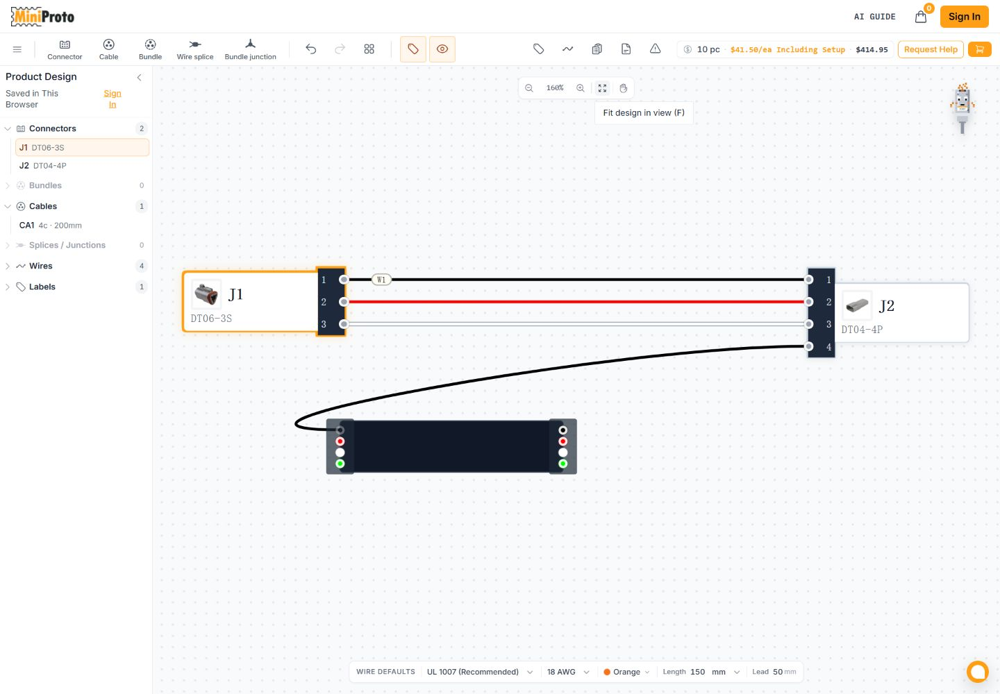

# MiniProto 浏览器实测与 Livewire 对比分析

日期：2026-11-16。目标系统：`D:\wire-harness-designer`。

## 1. 结论

可以借鉴两家产品优化现有系统，优先完善现有能力之间的衔接。

- **MiniProto**：本轮实测体现了物料选择、接线编辑、设计校验、材料成本和装配报价之间的联动，适合参考客户配置与询价体验。
- **Livewire**：此前截图确认了原理图、线束布局、工程表格和 PDF 输出，适合参考工程设计与交付资料组织。本轮核对了官网，但应用需要登录，未新增登录后的实测。
- **当前系统**：已经具有多芯护套线、接线明细、BOM、制图、服务端核价和成本权限。优先增加可操作的问题列表、集中接线编辑和人工核价交接；不需要重新建设整套平台。

本文是调研结果和建议，不是已批准的开发需求。没有修改业务代码、数据库或现有用户项目，没有发送工程咨询、询价、订单或付款。

## 2. 测试条件与证据边界

使用 Codex 内置浏览器，新开 MiniProto 标签页。该浏览器的访客存储与用户截图中的 Edge 会话不同：内置浏览器购物车初始为 0，用户截图中的购物车为 8 项，两者不能混为同一测试状态。

初始视口显示“Editing requires a larger screen”，无法编辑；临时切换到 1440 × 1000 后进入桌面配置器，测试结束恢复默认视口。首次向导含六步：开始、构建画布、配置物料、接线、检查、保存与订购。

首次打开载入了 `Product Design` 示例，含 J1 `DT06-3S`、J2 `DT04-4P` 和三根导线。本轮基于该示例测试，没有清空用户已有画布。测试所用配置为公开目录和虚构学习数据，没有上传项目文件、客户信息或凭据。

证据等级：

| 标记 | 含义 |
| --- | --- |
| 本轮实测 | 内置浏览器实际操作后读取界面结果，并在关键阶段保存截图 |
| 历史截图 | 用户此前提供的 Livewire 操作截图，详见原调研上下文 |
| 官网声明 | 页面描述，不能代替受控测试 |
| 本地代码 | 阅读当前工作区指定文件，未等同于部署环境验收 |
| 待验证 | 本轮未完成或无法确定的规则，不作为已确认产品能力 |

## 3. MiniProto 实测记录

| 编号 | 操作 | 实际结果与边界 | 证据 |
| --- | --- | --- | --- |
| T01 | 检查连接器属性及 Change 入口 | 可按料号、系列、孔数选型；列表有图片、描述、价格；连接器属性列出逐孔导线、线径、端子和附件。本轮未执行不同孔数替换及接线映射测试 | [选型](13-connector-selection.jpg) |
| T02 | 默认示例数量从 1 改为 10 | 单件含设置费显示从 $91.66 变为 $19.82；10 件总价 $198.15；存在重新估价中的禁用状态 | [10件报价](01-pricing-10pcs.jpg) |
| T03 | 接线表将 J1:1 → J2:1 从 1000 mm 改为 500 mm | 三根导线总长从 3000 变为 2500 mm；该行显示成本从 $0.39 变为 $0.20；相同阶段的10件报价从 $198.15 变为 $194.35 | [接线表](02-wire-table-500mm.jpg) |
| T04 | 打开 Errors，点击 J1 的 Add wedgelock，再选择 W3S | 按钮先定位连接器附件配置，不是直接补齐。选择兼容 W3S 后，锁片警告从2条变1条；再为 J2 选择 W4P，消除其锁片警告 | [修改前](03-validation-before.jpg)、[J1修改后](04-validation-after-j1.jpg) |
| T05 | 将第一根线从18 AWG改为8 AWG | 允许暂时保存不适配规格，但两端各产生1条阻断：Deutsch DT 端子允许14–20 AWG；加入购物车按钮禁用；Fix wire W1可打开该线属性 | [阻断提示](05-gauge-blocking.jpg) |
| T06 | 从 Fix wire W1 恢复18 AWG | 属性显示兼容线径，候选中不兼容值有 `(!)`；恢复后 Errors 显示 No design errors，加入购物车恢复可用 | [恢复后](06-validation-cleared.jpg) |
| T07 | 添加 Cable 并选择 `30-00380` | 可配置4芯18 AWG UL2464电缆、200 mm护套主体、两端25 mm热缩；不接入任何导线时提示 CA1 未连接有效导线并禁用加入购物车 | [电缆属性](08-multicore-properties.jpg) |
| T08 | 从J2第4孔拖到CA1第一芯 | 新增 `J2:4 → CA1:1`；接线表统计为3根独立线、1条电缆芯线，总表列长度2700 mm；芯线类型显示CA1，规格随电缆呈现 | [芯线接线表](09-cable-conductor-table.jpg) |
| T09 | 检查加入电缆后的BOM | 电缆按 `30-00380` 单独计料：约0.66 ft、$3.81；未把已接入的电缆芯线再列为一根独立购料线；锁片与逐孔端子也进入BOM | [BOM](10-cable-bom.jpg) |
| T10 | 刷新页面 | 测试数量10、两连接器、三根独立线、CA1及其接线恢复；这是同一浏览器访客草稿恢复，不代表跨设备云保存 |
| T11 | 检查 Request Help | 表单说明发送当前设计给工程团队，可填写说明和邮箱；本轮只查看，未输入或提交 | [工程帮助](12-engineering-help.jpg) |
| T12 | 在Labels表中给W1添加标签 | 自动生成文字W1、热缩标签类型、A端25 mm偏移；提供自动/自定义文字、类型和位置字段；画布及报价更新 | [标签表](15-label-table.jpg) |
| T13 | 查看File菜单与Library | 访客可进入目录入口，但Library加载后要求登录；Duplicate禁用并提示需登录，Version History也禁用。Share Design点击后未观察到可确认的分享结果，不宣称已验证 |

测试结束配置：J1 `DT06-3S`、J2 `DT04-4P`，三根独立线500/1000/1000 mm，锁片W3S/W4P，CA1 `30-00380` 200 mm、其中一芯接J2:4，W1有一个标签，数量10。最终估价显示 $41.50/件、合计 $414.95，属于测试时估价，未创建订单。

## 4. 值得借鉴的产品行为

### 4.1 让问题变成可执行的任务

缺锁片提示有部件、原因和处理入口；错误线径明确指出连接器、PIN、导线和允许范围，点击可进入相关属性。修改后自动改变警告数量和可报价状态。

值得借鉴的是“发现问题 → 定位对象 → 修改 → 重新检查”的闭环。当前系统 `ValidationIssue` 已有 severity、code、entity、message、suggestedAction；可以在此基础上增加入口和导航。若需精确定位某一芯线，应再补充分辨接线明细的引用，不能仅凭物料ID假定已具备逐芯定位能力。

### 4.2 区分工程接线与购料实体

接线表区分独立导线和电缆芯线，BOM以实体电缆计料。这一点与当前系统 `CanvasWireMaterial`、`MaterialCircuit.coreIndex` 的方向一致，应保留现有模型优势，避免导入或汇总时将多芯线拆成多根实体线重复计价。

### 4.3 在集中表格中修改重复规格

MiniProto接线表可直接改长度、类型、线径和颜色，并显示总长、开放端统计及成本。界面还有多选、Fill Down和电子表格粘贴提示；本轮只实测了单行长度、线径修改，未验证批量粘贴。

当前系统可先围绕现有接线明细建立表格与画布选择联动，再决定是否增加固定格式Excel导入。批量操作必须保留物料归属、芯线索引及端点，不能只按显示文字重建数据。

### 4.4 报价反馈明确，但不混淆材料成本与售价

MiniProto报价抽屉显示数量档位、总价、交期选项，以及Variable Assembly Price和Setup。修改时进入估价中状态，暂时禁用加入购物车。

初始示例的数量档位为：

| 数量 | 含设置费的显示单价 |
| --- | --- |
| 1 | $91.66 |
| 10 | $19.82 |
| 25 | $14.81 |
| 50 | $12.68 |
| 100 | $11.32 |
| 250 | $10.34 |

1件时Setup显示$75.42，10件时显示$62.85，因此不能推断它只是在摊销一个固定设置费。总价$198.15与显示单价$19.82×10有舍入差异，也不能直接判为计算错误。

当前系统已有服务端核价和内部成本权限，不应照搬竞品把内部成本对所有访客公开。若未来增加数量折扣或设置费，需要先确认本地真实业务规则，再定义金额精度和展示方式。

### 4.5 把配置带进人工交接

Request Help直接说明会携带当前设计；只要求补充说明和邮箱。这有助于避免用户重新整理料号、接线和长度。

当前系统自动报价边界明确，适合将不支持的方案形成待核价资料，包含配置版本、BOM、接线、数量、未满足规则和图纸。优先保存在系统内部供人工处理；是否发送到外部渠道应另行授权。

## 5. 不应直接照搬或下结论的部分

1. **无错误不等于制造完整。** CA1仅一芯接入J2、另一侧尚未接入其他连接器时，Errors仍显示无错误，加入购物车可用。可能允许开放端或部分芯线使用；本轮未验证端部加工及未用芯线的制造要求，不能直接判为Bug。当前系统应按业务区分草稿、接线有效、报价可用和制造就绪。
2. **表列长度不等于BOM用量。** 1000 mm导线在BOM显示3.77 ft，500 mm显示1.89 ft，而200 mm电缆显示0.66 ft；导线表成本和BOM成本也有差异。可能包含用量余量，但未确认公式，不能把推测的百分比直接当作制造损耗规则。
3. **BOM未按相同端子合并。** 同一端子可出现多行、每行数量1。它适合逐孔核对，但采购汇总可读性有改进空间。当前系统应保留“安装明细”和“同料汇总”各自用途。
4. **连接器与电缆的外观不同。** 官网和界面入口说明不同对象的功能，但本轮没有完整验证Bundle、junction、splice复杂路径、保护层长度、分支计料及跨路径接线。
5. **访客能力存在边界。** 刷新恢复已验证，云保存、版本历史、团队目录、跨设备恢复和分享权限未验证。
6. **价格只作为交互证据。** 本轮没有验证Rush/Economy对价格的影响，也没有验证人工审核后的最终价格、税费、运输和交期兑现。

## 6. 两家竞品与当前系统的比较

| 维度 | Livewire | MiniProto | 当前系统及建议 |
| --- | --- | --- | --- |
| 工作重点 | 官网强调原理图、线束、文档同步；历史截图确认工程输出 | 本轮确认目录选型、配置校验、即时估价和人工帮助入口 | 面向实际线束设计与M8/M12加工报价，优先补交接体验 |
| 表格与画布 | 历史截图有Connector/From-To/Wire Table | 本轮可从表格改规格并触发报价更新 | 复用MaterialCircuit，做统一接线编辑和定位 |
| 校验 | 历史截图确认悬空、未用PIN等DRC | 本轮确认锁片提醒、线径阻断及修复入口 | 复用validateHarness，完善可见入口和阶段规则 |
| 物料关系 | 历史截图确认端子、适用孔位、配对件 | 本轮确认逐孔端子及兼容锁片选择 | 按实际分体连接器业务扩展，不强制为全部物料建复杂关系 |
| 多芯线 | 本轮未新增实测 | 本轮实际选料、接入芯线、分别计料 | 已有多芯护套线模型，应完善操作和输出表达 |
| 工程交付 | 历史截图已试导出带表格与图框的PDF | 本轮未确认PDF/Excel下载能力 | 延续现有制图，补资料完整性检查、来源和预览 |
| 价格与权限 | 本轮未验证 | 本轮验证数量、长度、附件、标签触发估价更新 | 已有服务端计算及角色控制，应保留权限边界 |

Livewire官网本轮重新确认：原理图与线束关联、From-To电子表格导入、AI物料搜索、规则检查、Excel/PDF输出均为公开描述。复杂双向传播、导入容错和搜索准确度仍需登录后测试。

## 7. 对当前系统的建议优先级

以下为候选方向，未改代码；验收点用于下一步明确范围，不是已执行结果。

| 优先级 | 候选改进 | 现有基础 | 建议验收点 |
| --- | --- | --- | --- |
| P1 | 设计问题面板与对象定位 | `src/lib/validation.ts`、`ValidationIssue` | 对已覆盖的无效PIN、接线侧冲突等问题能定位；改正后消失；明确阻断对象和操作，允许保存草稿 |
| P1 | 集中接线表与画布联动 | `MaterialCircuit`、`coreIndex`及现有线材模型 | 表格与画布选择同一数据；修改长度、规格或端点后相关输出刷新；多芯线不重复计料 |
| P1 | 报价状态与人工交接 | `quoteForRole`及ready/blocked/manual | 显示配置对应的核价状态；超范围原因明确；生成可供人工处理的配置资料；内部成本权限保持有效 |
| P2 | 工程输出前检查与预览 | 现有BOM和制图生成 | 提示缺规格、占位件、未处理端部；工程表与BOM来源一致；单位、单根长度及总用量可解释 |
| P2 | 受控连接器替换 | 连接器与PIN引用 | 明确PIN映射和受影响接线，确认后重校验，可撤销；实施前核查当前替换行为 |
| 按需 | 端子/锁片/附件适配与复杂接续点 | 按真实业务确认 | 先覆盖实际使用的系列或接续场景，再扩展；不为竞品功能数量引入复杂模型 |

本轮代码复核发现，旧上下文仅提M12不够准确：`server/pricing.ts` 当前允许M8和M12；`server/quoteService.ts` 仍限制一根实体护套线、一个或两个连接器，禁止保护套，并校验芯数及屏蔽一致。超过5000 mm返回人工核价。

`quoteForRole` 已返回 `settingsVersion`、`calculatedAt`，且依据角色决定是否返回成本拆分。这些已有能力应复用，不能被写成从零新增的需求。

当前 `validateHarness` 的非测试直接调用在 `src/lib/designFile.ts` 导入/导出流程中；已有问题结构可以作为检查面板的数据基础，但不能据此宣称页面端已完成实时校验。

## 8. 尚未验证与后续接续

- Livewire在内置浏览器停留登录页；若继续，可由用户在该标签页自行登录，无需在聊天中发送密码。
- MiniProto：复杂分支、splice与junction语义、Bundle长度与导线路径、保护层实际用量、多芯电缆两端完整接线、导出、分享、云保存及版本历史。
- 未提交人工帮助、未加入购物车、未结算；仅查看表单和按钮状态，不能声称完成订单闭环。
- 本地系统本轮仅阅读相关代码，没有启动应用做页面走查，也没有运行代码测试，因为只新增调研材料和证据。

建议下一步先确定P1三项中最影响当前用户的一项，并结合本地页面核实具体缺口，再形成实施范围。无需继续把学习样例整理成生产图纸来证明上述基础行为。

## 9. 来源与证据文件

- [MiniProto配置器](https://www.miniproto.com/configuratorV2)：本轮实测。
- [Livewire应用](https://livewirecad.ai/)：本轮确认登录要求。
- [Livewire官网](https://www.livewirecad.com/)：本轮核对公开产品描述。
- [前期调研上下文](../../livewire-miniproto-research-context-2026-11-16.md)：历史截图与公开资料。

本目录保留16张原始浏览器截图，编号01–16；包括报价、表格、校验前后、电缆、BOM、标签、人工帮助、连接器选型、Livewire登录页和最终画布。报告中的图片均为实际页面截图，未以示意图替代。
